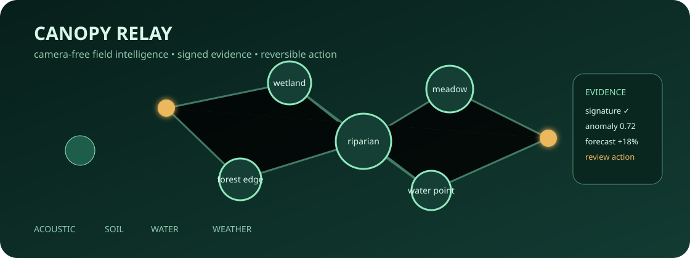
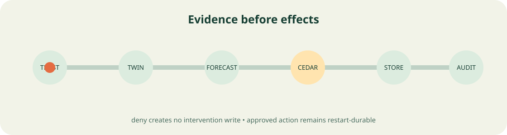

# Canopy Relay



Canopy Relay is a camera-free ecological field-operations product for a synthetic Toronto ravine. A React console submits trusted sensor evidence, reviews a mesh-loss anomaly, requests a bounded relay intervention, and retrieves the same linked audit after browser refresh and backend restart. The Rust backend owns trust, calibration, anomaly scoring, upstream composition, policy, persistence, and audit verification.

This is not a wildlife-surveillance system, generic dashboard, or scientific efficacy claim. It demonstrates a complete governed product path over public synthetic data.

## Operator experience

- **Habitat Map:** inspect three connected habitat zones and live anomaly state.
- **Sensor Trust:** review provisioned devices, calibration status, and signed evidence.
- **Anomaly Workbench:** submit an observation through validation, replay control, calibration, robust scoring, provenance, and OpenDAL.
- **Intervention Planner:** request a reversible mesh relay; Cedar and five Ruvnet mechanisms execute before one durable intervention is returned.
- **Offline Mesh:** inspect the route transported through real LatentMesh fragmentation/reassembly.
- **Audit Vault:** inspect correlation-bound linked evidence and retrieve it after restart.

## Three acceptance journeys

1. **Primary:** submit signed evidence, render its observation receipt, authorize a relay intervention, and display the persisted result.
2. **Denial/recovery:** attempt a restricted action, prove intervention/audit counts do not change, then correct the action and succeed.
3. **Durable retrieval:** refresh the browser, replace the Rust backend process, and retrieve the same intervention and audit correlation from OpenDAL storage.

## Launch and lifecycle

```bash
./scripts/start.sh
```

The frontend is at `http://127.0.0.1:5173`; API readiness is at `http://127.0.0.1:18080/readyz`. Use `scripts/stop.sh` and `scripts/reset.sh` for bounded lifecycle operations. Docker Compose runs the built frontend, the default `cr-service` binary, and its persistent volume. Cloud Run files are configuration and rollback guidance only; nothing deploys or incurs spend.

## Executed composition

| Canonical upstream | Exact revision | Runtime responsibility |
|---|---|---|
| `ruvnet/RuCelium` | `813da13eb9a46b6acf78fe7ecc8c220ecf83b386` | sign, register, and verify an environmental sample |
| `ruvnet/worldgraph` | `9b1c79c836cdacfb7b44f058c593157bac4c1dab` | construct and serialize the target habitat node |
| `ruvnet/midstream` | `62c37c9e8d282a4249de41aaf63649230338f738` | execute DTW temporal comparison |
| `ruvnet/LatentMesh` | `df9270799a1391925c1840a1845a6d169aaa2d93` | fragment and reassemble a constrained-radio route |
| `ruvnet/ruv-FANN` | `f4ca36c2323d08eac822bac43b62040198721cbf` | run a deterministic bounded local forecast |
| `cedar-policy/cedar` | `5af7b8cd78e4e0da3ae23f1715023fff8e62941d` | authorize the intervention before upstreams and writes |
| `apache/opendal` | `532050ac3c099dd8591cde652a8ed1aaf03ba418` | persist and restore namespaced observations, interventions, and audit |

Every ingredient has a real call site, success and failure tests, probe evidence, final runtime evidence, and a named ablation. See the [integration matrix](docs/integration-matrix.md).

## Architecture

The production path is `React -> checked TypeScript client -> /api/v1 -> middleware -> CanopyRelay -> domain crates -> five Ruvnet clients -> Cedar/OpenDAL -> verified repository/dashboard -> React`. Locked offline Cargo metadata reaches 29 Rust packages. Independent semantic review counts 22 distinct product crates and deliberately excludes seven repeated support-ledger packages from the meaningful total.

See [architecture](docs/architecture.md), [specification](docs/specification.md), [research](docs/research.md), [traceability](docs/traceability.md), [crate call paths](docs/crate-to-backend-call-path.md), [prototype acceptance](docs/prototype-acceptance.md), [25 ADRs](docs/adr/index.md), and [12 DDD documents](docs/ddd/index.md).



## Verification

```bash
./scripts/verify-prototype.sh
```

The wrapper collects the ten required suites and always executes the canonical full-product gate. Verification covers formatting, strict Clippy, locked tests, dependency/license checks, frontend typecheck/lint/unit/build, API drift, middleware, all upstream success/failure tests, browser journeys, backend restart, benchmark, seven ablations, container readiness, Cargo metadata, the canonical gate bundle, semantic review, and Rust source share.

| Product gate | Required result |
|---|---|
| Meaningful Rust crates | 22 counted; 29 reachable |
| Design corpus | 25 ADRs and 12 DDDs with reciprocal mappings |
| Upstreams | 5 Ruvnet and 2 enterprise executed |
| Browser acceptance | 3 journeys on desktop and mobile |
| Evidence | exact-source schema-v2 artifact and semantic review |
| Rust source | at least 50% recognized tracked source bytes |

## Limitations

The data, coordinates, weights, and intervention are synthetic. WorldGraph contains one operational zone node; Midstream compares a deterministic baseline; LatentMesh proves message transport rather than live radio; ruv-FANN uses fixed untrained weights; the five-score mean is not a scientific objective. The bearer format is prototype authentication, filesystem OpenDAL is not distributed storage, and the console does not implement role-specific sensitive-location projection. Canopy Relay must not automate irreversible ecological work or be treated as a certified conservation decision system.
