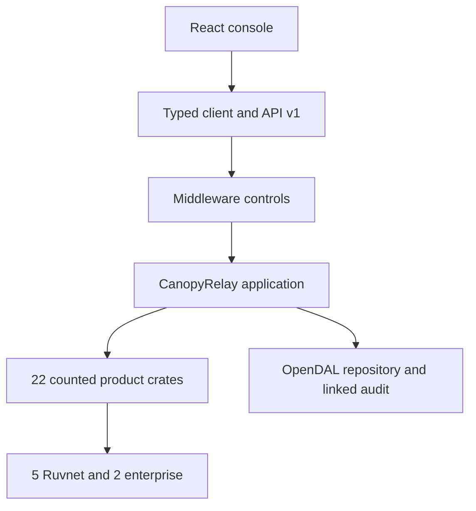

# Architecture

Canopy Relay is a Rust application with a versioned Axum API and a React/TypeScript console. `cr-service` is the sole production composition root. It restores OpenDAL state, compiles Cedar, constructs five Ruvnet clients, creates `CanopyRelay`, and registers middleware and routes.

## Bounded contexts

1. **Observation Trust:** device provisioning, one-use receipts, calibration, robust anomaly state, and input provenance.
2. **Habitat State:** deterministic zone/sensor/anomaly/link state, WorldGraph projection, and coherent dashboard.
3. **Temporal Intelligence:** local robust detector, Midstream DTW, and bounded ruv-FANN forecast.
4. **Field Transport:** LatentMesh route fragmentation and reassembly.
5. **Intervention Governance:** typed validation, hard safety exclusion, Cedar authorization, upstream composition, and commit invariants.
6. **Evidence Continuity:** OpenDAL objects, repository restore, audit verification, and correlated retrieval.
7. **Product Delivery:** API/client drift control, middleware, frontend, scripts, containers, and evidence collection.

## Production flows

**Observation:** `React -> client -> POST /api/v1/observations -> middleware -> cr-api -> CanopyRelay::observe -> cr-contracts -> cr-device-trust -> cr-calibration -> cr-temporal-anomaly -> cr-provenance -> cr-repository/OpenDAL -> linked audit -> response`.

**Intervention:** `React -> client -> POST /api/v1/interventions -> middleware role -> cr-api -> CanopyRelay::intervene -> request validation -> hard safety exclusion -> Cedar -> cr-upstream-compose -> RuCelium -> WorldGraph -> Midstream -> LatentMesh -> ruv-FANN -> cr-repository/OpenDAL -> linked audit -> dashboard response`.

**Restart retrieval:** `new cr-service process -> OpenDAL list/read -> cr-repository sort and verify audit -> cr-dashboard invariant checks -> GET /api/v1/interventions and /audit -> React`.

## Middleware and API

Tower registers CORS, tracing, a 30-second timeout, and `product_controls`. Product controls bypass only health endpoints, normalize correlation, authenticate the bearer, enforce `field-lead` on intervention POST, require JSON on mutations, and correlate errors/responses. Cedar repeats authorization at the effect boundary. Routes live under `/api/v1`; committed OpenAPI and the TypeScript client are mechanically drift-checked.

## Crate accounting

The production graph reaches 29 workspace packages. Independent review counts 22 with distinct responsibilities and excludes seven production-reachable record-ledger support packages (`cr-audit`, `cr-habitat-graph`, `cr-ingest`, `cr-intervention`, `cr-mesh-transport`, `cr-neural-forecast`, `cr-observability`) from the meaningful total. The [call-path map](crate-to-backend-call-path.md) records the reciprocal design and test evidence.

No selected upstream or model score authorizes an action. No response reports a committed intervention before OpenDAL and the linked audit succeed.
